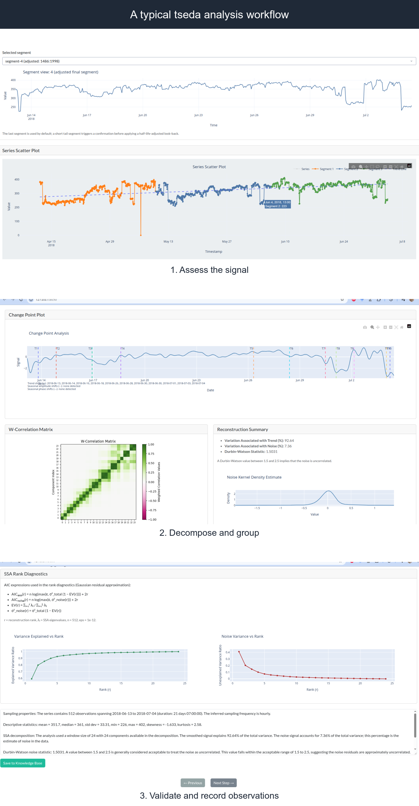

# tseda

<div align="center">
  
</div>

<p align="center">
  
  
  
</p>

---

`tseda` is a Python package for analyst-guided time-series decomposition, diagnostics, and signal validation. It helps analysts turn regularly sampled operational data into interpretable components such as trend, seasonality, and noise while keeping the analysis explicit, repeatable, reviewable, and auditable.

For the fuller product story, design rationale, and detailed explanation of the workflow, see [about_tseda.md](about_tseda.md).

`tseda` helps analysts move from raw data to a defensible decomposition without sacrificing transparency. It supports exploratory analysis and model development by surfacing a signal's variance structure, highlighting regime changes, and making analytical choices easy to revisit and refine.

## What it helps with

- understanding whether a signal has meaningful structure,
- separating trend and recurring seasonal behavior from residual noise,
- identifying regime changes and shifts in operating behavior,
- deciding whether a series is suitable for decomposition and modeling,
- preserving earlier analytical decisions so they can be revisited and repeated.

## Why it exists

The hard part is not a single plot or statistic, but the sequence of choices needed to reach a defensible decomposition: selecting a sensible window, identifying regime boundaries, choosing component groups, checking whether the result is structurally meaningful, and documenting the reasoning for later reuse. See [about_tseda.md](about_tseda.md) for details.

`tseda` brings those steps together in one workflow.

### Key considerations

- `tseda` is an **exploratory** tool that provides a quick baseline for understanding a dataset's variance components and overall characteristics. It gives analysts a starting point for deeper tuning and refinement, helps modelers understand the variance structure before building a pipeline, and may be sufficient for quick operating-condition checks or a first-pass read of a series.
- The window size and other analysis parameters can be manually set by the expert user in the UI. All algorithmic parameters are configurable, and by inspecting the repository you can understand the specific methods used in the software and tune them for your context.
- There is **full notebook parity**: expert users can investigate finer-grained analytical nuances directly in a notebook.

## Why it matters

Variance decomposition is useful not only to modelers, but also to the teams responsible for monitoring and operating systems. Modelers use the extracted behaviors to decide which patterns a forecasting or anomaly-detection model must represent explicitly. Operations teams can use the same information to define alerts and establish guidelines for what behavior is expected from a signal.

Segmentation shows how often a signal changes behavior and identifies the current operating regime. Decomposition then describes that regime in terms of components such as trend, seasonality, and residual noise. Together, these results give an operations team historical evidence about how frequently changes occur, how much variation is normal, and when a signal has moved into a behavior that deserves investigation.

Evaluation across real-world and benchmark datasets shows that explained variance differs substantially by signal, as expected from the diversity of operational data. Structured examples such as coffee prices capture a large share of the signal through trend and/or seasonality, while noisier or weakly structured series retain more residual noise. The method therefore reflects how informative and interpretable a signal is rather than forcing structure onto every dataset.

The evaluation is intended to show that the approach produces useful, stable diagnostics across real datasets rather than a single tuned result. Across the tested benchmark set, the Durbin-Watson statistic remains within the acceptable 1.5 to 2.5 range, indicating limited residual autocorrelation and a statistically reasonable decomposition. These results suggest that `tseda` is suitable for structured exploratory analysis, model development, and monitoring workflows.

For bounded random variables, whose values lie within a known range `[a, b]`, concentration inequalities can provide bounds on unusually large observations within a regime. Support for bounding the maximum value of a signal in this way is an upcoming `tseda` feature. Until then, segmentation and variance decomposition still provide practical inputs for monitoring: they make regime changes, changing component behavior, and the level of background noise visible and reviewable.

## How is it used?

`tseda` supports a three-step workflow:

1. initial assessment of the signal,
2. decomposition and grouping of the signal components,
3. validation and observation logging.

The package is designed to work both in a browser-based UI and in Python notebooks, with the same core workflow exposed in both environments.

### From raw series to reviewable analysis

A typical analysis moves from identifying meaningful segments, through decomposition and
grouping, to validation and recorded observations. The same workflow can be explored in
the UI or reproduced through the notebook API.

<p align="center">
  
</p>

This progression makes the analytical decisions visible: first define the regime being
studied, then identify its components, and finally check whether the result is
statistically reasonable and worth preserving.

## Installation

```bash
python -m venv .venv
source .venv/bin/activate
pip install tseda
```

Then run:

```bash
tseda
```

## Quick start

```python
from tseda.notebook_api import NotebookThreeStepAPI, load_example_series

series = load_example_series("coffee_prices")
api = NotebookThreeStepAPI(series)

kde_fig = api.get_kde_plot(show_kde=True, bin_algorithm="scott")
acf_fig = api.get_acf_plot(lags=30)

api.set_window(api.get_window(), apply_window_refinement=True)
grouping, dw_ok = api.suggest_grouping()
api.set_grouping(grouping)
recon_fig = api.get_reconstruction_plot()

summary = api.generate_observation_text()
print(summary[:500])
```

## UI Example Illustrations

For examples of using tseda with the UI, please see the following links:

- [Coffee prices example](documents/coffee_example.md)
- [Car sales example](documents/car_sales_example.md)
- [Biomass power generation example](documents/biomass_power_gen_example.md)
- [White noise example](documents/white_noise_example.md)

## Testing

Testing covers heterogeneous real-world and benchmark conditions to verify that the workflow produces actionable diagnostics rather than a single narrow, tuned outcome. As described above, clearly patterned data such as coffee prices show stronger decomposition, while irregular or noisy series retain more residual variation. The Durbin-Watson statistic remains within the healthy 1.5 to 2.5 range across the evaluated datasets, indicating limited residual autocorrelation and statistically stable results. For the detailed test setup, generated report, full results table, exact running instructions, and complete outcomes, see [documents/test_datasets_report.md](documents/test_datasets_report.md).

## More information

- [about_tseda.md](about_tseda.md) — fuller product overview and narrative explanation
- [documents/coffee_example.md](documents/coffee_example.md) — worked coffee-prices example showing the segment-first workflow, preliminary diagnostics, and final-segment adjustment
- [documents/car_sales_example.md](documents/car_sales_example.md) — trend-cycle example with evolving operating behavior and no fixed seasonal rhythm
- [documents/biomass_power_gen_example.md](documents/biomass_power_gen_example.md) — renewable generation example highlighting non-seasonal trend-driven change
- [documents/PRODUCT.md](documents/PRODUCT.md) — product and user-value context
- [documents/ARCHITECTURE.md](documents/ARCHITECTURE.md) — system architecture
- [docs/tutorial.md](docs/tutorial.md) — guided walkthroughs
- [docs/user_guide.md](docs/user_guide.md) — detailed usage guidance
