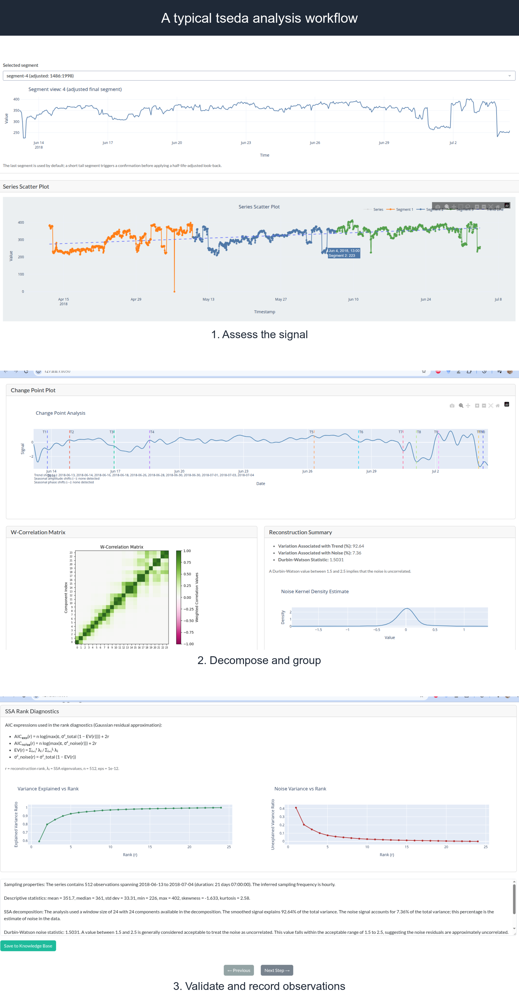

# tseda

<div align="center">
  
</div>

<p align="center">
  
  
  
</p>

---

`tseda` is a Python package for analyst-guided time-series assessment,
decomposition, diagnostics, and audit-ready observation logging. It first
determines whether a series is suitable for deterministic SSA. If supported, it
then applies window selection, component grouping, and periodic verification to
produce a traceable trend/seasonality/noise analysis.

The package is intended for cold-start exploration, not automatic model building.
It explicitly stops deterministic decomposition for diffuse noise or stochastic
persistence and recommends a more appropriate stochastic/differenced approach.

## What it helps with

- classifying a series as [diffuse noise, stochastic persistence, deterministic
  trend, periodic, mixed, stationary irregular, or indeterminate](documents/process_classification_reference.md);
- deciding whether deterministic SSA is suitable;
- identifying reproducible full-series and active-regime scopes;
- selecting an SSA window and verifying periodic component pairs;
- reporting residual-variance changes, diagnostics, and evidence.
- understanding operational data collection and signal interpretation in the broader workflow described in [documents/operational_context.md](documents/operational_context.md).

## Why it exists

The first question is not "which model should I fit?" but "is deterministic
decomposition defensible for this series?" `tseda` makes that assessment before
presenting SSA grouping controls.

### Key considerations

- `tseda` is an **exploratory** tool that provides a quick baseline for understanding a dataset's variance components and overall characteristics. It gives analysts a starting point for deeper tuning and refinement, helps modelers understand the variance structure before building a pipeline, and may be sufficient for quick operating-condition checks or a first-pass read of a series.
- The window size and other analysis parameters can be manually set by the expert user in the UI. All algorithmic parameters are configurable, and by inspecting the repository you can understand the specific methods used in the software and tune them for your context.
- The notebook API exposes the same process classification, grouping, diagnostics,
  and reporting workflow as the UI.

## How is it used?

`tseda` supports a three-step workflow:

1. initial assessment of the signal,
2. decomposition and grouping of the signal components,
3. validation and observation logging.

The package is designed to work both in a browser-based UI and in Python notebooks, with the same core workflow exposed in both environments.

### From raw series to reviewable analysis

A typical analysis moves from identifying meaningful segments, through decomposition and
grouping, to validation and recorded observations. The same workflow can be explored in
the UI or reproduced through the notebook API.

<p align="center">
  
</p>

This progression makes the analytical decisions visible: first define the regime being
studied, then identify its components, and finally check whether the result is
statistically reasonable and worth preserving.

## Method details

- [Decomposition process specification](documents/decomposition_process_spec.md)
  describes the sequential suitability gates and the point at which `tseda` stops
  or proceeds to deterministic SSA.
- [Window selection](window_selection_algorithm.md) describes cadence-based SSA
  window initialization, candidate periods, and refinement.
- [Seasonality decomposition](documents/seasonality_decomposition.md) describes
  how paired SSA modes, period evidence, cycle support, and independent spectral
  checks verify a seasonal component.

## Installation

```bash
python -m venv .venv
source .venv/bin/activate
pip install tseda
```

Then run:

```bash
tseda
```

## Quick start

```python
from tseda.notebook_api import NotebookThreeStepAPI, load_example_series

series = load_example_series("coffee_prices")
api = NotebookThreeStepAPI(series)

kde_fig = api.get_kde_plot(show_kde=True, bin_algorithm="scott")
acf_fig = api.get_acf_plot(lags=30)

process = api.get_process_analysis()
print(process["process_classification"])

if process["decomposition_suitability"]["status"] == "suitable":
    grouping, dw_ok = api.suggest_grouping_with_window_autotune()
    recon_fig = api.get_reconstruction_plot()
    metadata = api.get_reconstruction_metadata()
else:
    print(process["decomposition_suitability"]["reason"])

summary = api.generate_observation_text()
```

For a stochastic-persistence result, `tseda` stops deterministic SSA exploration.
This guardrail matters because visual smoothing of a pure random walk can create
pareidolia: apparent trends or cycles that are not deterministic structure. The
recommended next step is a random-walk, ARIMA/differenced, local-level, or
state-space model; any residual or innovation series is a separate new analysis.

## UI Example Illustrations

For examples of using tseda with the UI, please see the following links:

- [Coffee prices example](documents/coffee_example.md)
- [Car sales example](documents/car_sales_example.md)
- [Biomass power generation example](documents/biomass_power_gen_example.md)
- [White noise example](documents/white_noise_example.md)

## Testing

Testing covers heterogeneous real-world and benchmark conditions with explicit
full-series and active-regime process classifications. The suite distinguishes
diffuse noise, stochastic persistence, deterministic trend, stationary irregular
variation, and verified periodic structure. Durbin-Watson is reported as a
residual diagnostic and boundary distance, not used to force a semantic
decomposition. For the detailed test setup, generated report, full results table,
exact running instructions, and complete outcomes, see
[documents/test_datasets_report.md](documents/test_datasets_report.md).

## More information

- [about_tseda.md](about_tseda.md) — fuller product overview and narrative explanation
- [documents/decomposition_process_spec.md](documents/decomposition_process_spec.md) — sequential process and suitability specification
- [documents/process_classification_reference.md](documents/process_classification_reference.md) — first-output category reference and recommended actions
- [window_selection_algorithm.md](window_selection_algorithm.md) — SSA window initialization and refinement
- [documents/seasonality_decomposition.md](documents/seasonality_decomposition.md) — periodic-pair verification and seasonal reconstruction
- [documents/coffee_example.md](documents/coffee_example.md) — worked coffee-prices example showing the segment-first workflow, preliminary diagnostics, and final-segment adjustment
- [documents/car_sales_example.md](documents/car_sales_example.md) — monthly trend-plus-seasonality example with a verified 12-month cycle and an underpowered final regime
- [documents/biomass_power_gen_example.md](documents/biomass_power_gen_example.md) — renewable generation example highlighting non-seasonal trend-driven change
- [documents/PRODUCT.md](documents/PRODUCT.md) — product and user-value context
- [documents/ARCHITECTURE.md](documents/ARCHITECTURE.md) — system architecture
- [docs/tutorial.md](docs/tutorial.md) — guided walkthroughs
- [docs/user_guide.md](docs/user_guide.md) — detailed usage guidance
