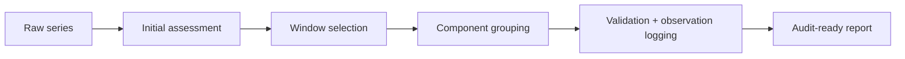

# Diagram assets

This directory holds repo-native schematic sources for tseda.

## GitHub-rendered diagrams

For diagrams that should render directly on GitHub, prefer Mermaid in Markdown. Example:

## TikZ source and generated SVGs

The repository also includes TikZ source files that are rendered to SVG during CI so they can be checked into version control and displayed on GitHub.

- `tseda_workflow.tex` — end-to-end workflow schematic
- `tseda_decomposition_flow.tex` — sequential decomposition flow
- `tseda_process_classification.tex` — process decision map for noise, persistence, and periodic structure
- `tseda_active_regime_flow.tex` — full-series vs active-regime scope logic
- `tseda_stage_breakdown.tex` — stage-by-stage decomposition sequence
- `tseda_operational_context.tex` — raw-source to signal-summary workflow for regular operational data

The GitHub Action at `.github/workflows/render-diagrams.yml` renders these to SVG whenever the diagram sources change.

## Typical workflow

1. Edit the `.tex` source in `docs/diagrams/`.
2. Commit the change.
3. CI renders the SVG assets automatically.
4. The generated `.svg` files are committed back to the branch so they display natively on GitHub.
