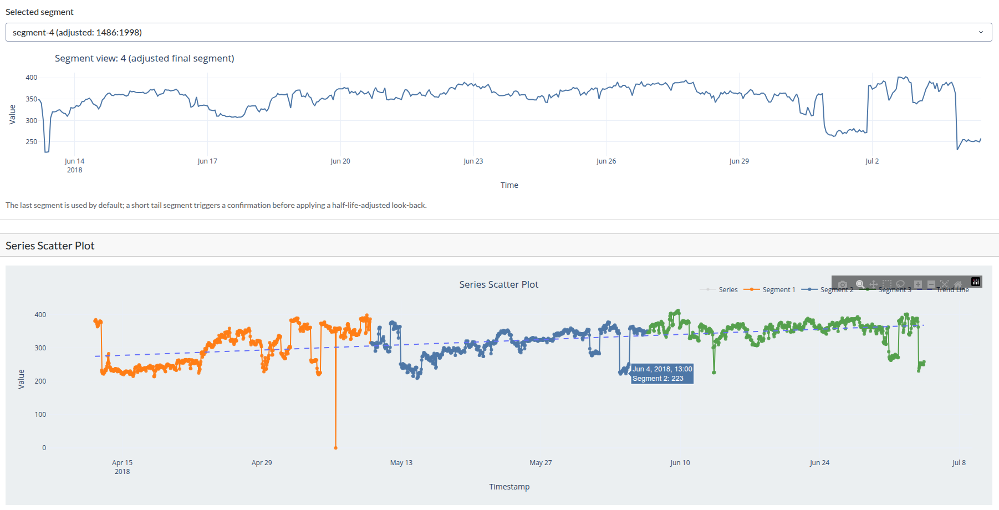
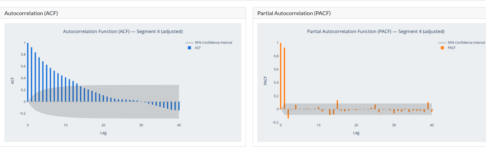
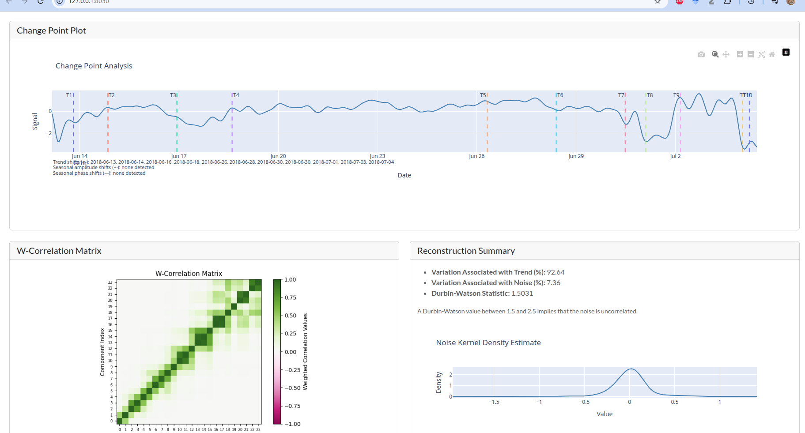
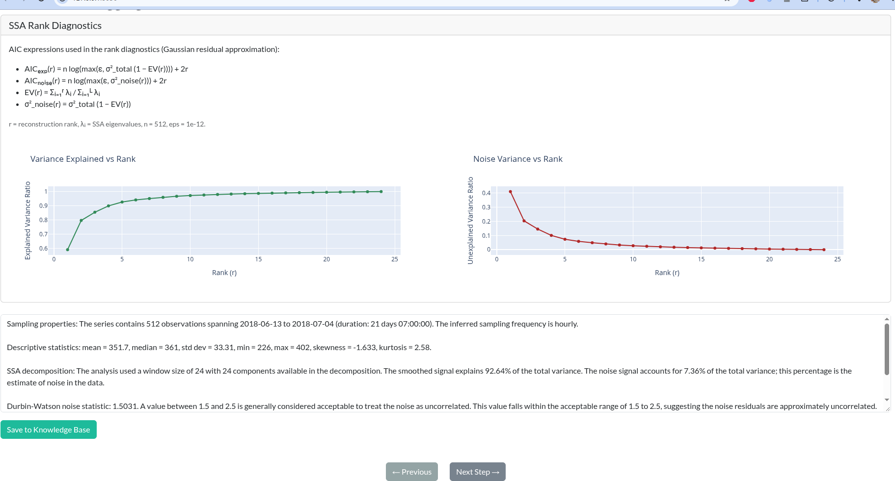

# Biomass power generation example: trend-driven renewable output without a stable seasonal cycle

This example uses the biomass power generation series from the European Union electricity dataset, following the ENTSO-E reporting structure for renewable generation. Biomass is treated as a distinct generation type in the EU electricity system and is widely tracked for operational, regulatory, and market analysis. The data is therefore useful not only as a renewable-generation indicator, but also as a case study in how a time series can show important structural change without the fixed periodicity that one typically associates with a seasonal signal.

The series used here is the trimmed biomass generation dataset at [../data/trimmed_biomass%20-%20generated_biomass_MW_series.csv](../data/trimmed_biomass%20-%20generated_biomass_MW_series.csv). It captures a period in which biomass output changes materially over time, with visible shifts in level and persistence that are more consistent with evolving regime behavior than with a clean repeating seasonal pattern.

## 1. Preliminary analysis: understanding the raw signal before decomposition

The starting point is the raw biomass series itself. The preliminary views show the observed generation profile over time and provide the first indication that this signal is not dominated by a strict seasonal structure. Instead, the level of generated power evolves over broader intervals, with sustained periods of increase or change that reflect underlying operational and market conditions rather than a repeating annual or monthly cycle.

The accompanying ACF and PACF diagnostics help further explain the signal shape. The presence of autocorrelation at longer lags, without a stable repeating seasonal signature, suggests that the signal is governed more by a changing trend-cycle than by a fixed seasonal component. In other words, the series has meaningful temporal dependence, but not the kind of regular repetition that would classify it as strongly seasonal.

The segmentation view reinforces this interpretation. Rather than seeing a clean seasonal rhythm that repeats at a fixed frequency, the series appears to shift across different operating regimes. That is exactly the kind of pattern for which a decomposition workflow is useful: it separates the long-run movement of the series from the residual variability that remains after the main signal structure is accounted for.

## 2. Decomposition: separating trend behavior from residual variation

The next step is SSA decomposition. This is the point at which the signal is separated into its principal components so the analyst can determine whether the dominant behavior is an evolving trend or a combination of trend and recurring seasonal structure. In this biomass example, the decomposition makes a particularly important finding: there is no strong seasonal component. The main structure is instead a trend component that changes over the observation period.

This result matters because it tells the analyst something fundamental about the series. Biomass generation is not best interpreted as a signal with a stable repeating annual cycle. Instead, it behaves more like a trend-driven renewable output process: sustained changes in generation over time, with variation around that underlying movement rather than a fixed seasonal rhythm. That makes the trend component the most important explanatory structure, while the remaining residuals capture the irregular variation that the trend alone cannot explain.

This is the type of series for which decomposition is especially valuable. The analyst can distinguish persistent changes in output from short-run variation and make a more defensible judgment about the signal’s operating behavior. It also helps answer whether the observed pattern is likely due to real changes in renewable generation strategies, operational conditions, or supply-side dynamics rather than a cyclical pattern that repeats at a regular interval.

## 3. Model validation and observation logging

Once the decomposition is in place, the workflow moves to validation and documentation. In this last stage, the analyst checks whether the extracted components are statistically coherent and whether the interpretation remains defensible in light of the data. The project records this evidence in the observation log so the decision process can be revisited later, which is particularly important for renewable-generation monitoring where operational conditions and policy environments can change over time.

The observation log captures the selected analysis window, the decomposition outcome, and the interpretive conclusions. In this biomass example, the validation evidence supports the view that the dominant behavior is change in the trend rather than a fixed seasonal effect. That conclusion is useful for monitoring and planning because it shifts the emphasis away from trying to forecast an annual pattern and toward tracking how overall generation is evolving in response to structural drivers, technology adoption, or fuel availability.

The biomass generation example therefore illustrates an important use case for `tseda`: not every operational signal is seasonal. Some series are better understood as nonstationary, trend-driven processes with changing operating regimes. By making that structural distinction explicit, the workflow helps analysts avoid overfitting a seasonal explanation where the underlying evidence points to broader directional change instead.