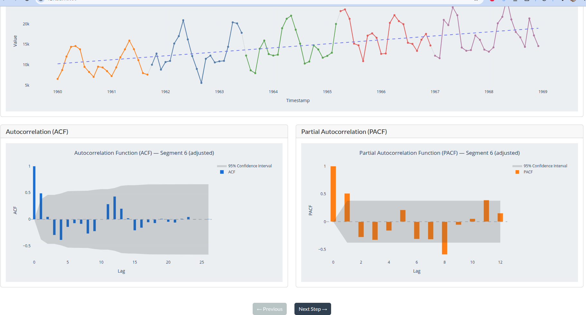
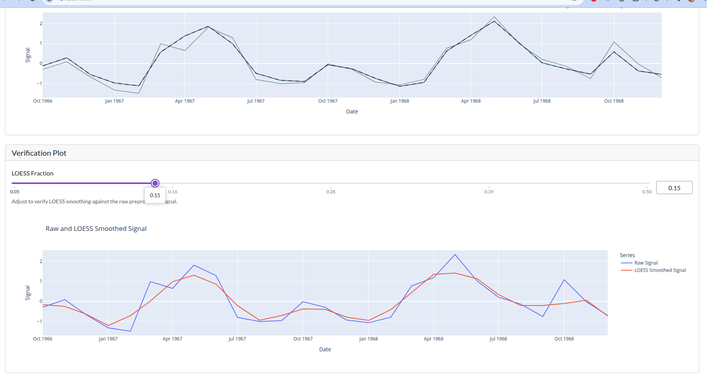
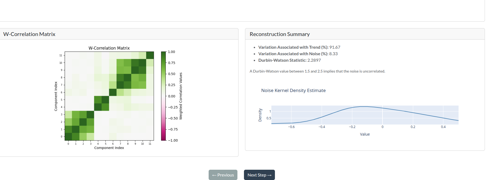
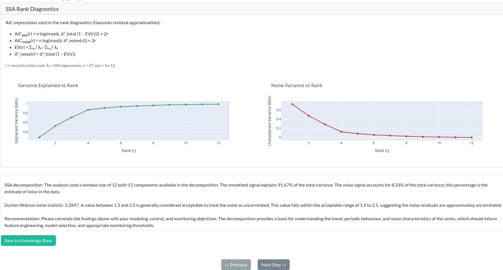

# Car sales example:

This example uses the [monthly car sales data](../data/monthly-car-sales.csv). It is a useful case for illustrating how a series can display clear cyclical movement without satisfying the usual definition of a seasonal signal. In this setting, the principal structure is a trend-cycle rather than a fixed seasonal pattern. The distinction matters: seasonal behavior repeats with a stable cadence, whereas a trend-cycle may move in cycles over time, but the timing and amplitude of those cycles are not fixed in a regular, repeating way.

This makes the monthly car sales series a compelling example of the kind of series where a decomposition workflow is valuable. The system is not simply trying to extract a repeating monthly pattern; it is trying to separate broad movement, irregular cyclical behavior, and residual variation in a way that is both interpretable and defensible.

Most of the workflow follows the same sequence used elsewhere in the project. The main goal here is to illustrate the most relevant aspects of the analysis and to focus on the diagnostic evidence that supports the chosen decomposition. For the remaining procedural details, readers can follow the same pattern described in the coffee example.

## 1. Preliminary analysis: recognizing the signal structure before decomposition

The first stage is to inspect the raw series as it appears in time. The initial view of the monthly car sales data reveals a clear cyclical pattern in the values over time. There is obvious variation in the level of sales, and the series does not look random or stationary. Instead, it exhibits a sustained movement that rises and falls over broader intervals rather than repeating with a fixed seasonal period.

This is an important clue when deciding how to model the series. When the autocorrelation function (ACF) is examined, there is no strong evidence of a regular repetition pattern that would normally indicate a seasonal component. A seasonal signal typically generates recurring autocorrelation peaks at a stable lag. In contrast, the monthly car sales data shows wider cyclical movement without that fixed interval structure. That is why the signal is better understood as containing a trend-cycle component than as being dominated by a stable seasonal cycle.

## 2. Decomposition: separating the long-run movement from the residual structure

Once the signal has been assessed, the next step is decomposition. Using SSA, the series is separated into interpretable components and reconstructed to show how the extracted structure explains the observed behavior. The decomposition view shows the signal broken into its main operating parts, and the reconstruction view illustrates how well those components explain the underlying dynamic.

In this case, the decomposition is especially informative because it distinguishes the broad trend-cycle from the residual structure. The long-run movement captures the underlying expansion and contraction in car sales over time, while the residual represents the non-systematic variation that remains once the dominant cyclical signal is accounted for. The fact that the selected components align with the observed behavior is an encouraging sign that the decomposition is capturing a real regime-level structure rather than forcing arbitrary separation.

The verification step then checks whether the extracted components behave in a statistically defensible way. A key diagnostic is the relationship between the noise component and the trend-cycle component. If the decomposition is appropriate, the residual noise should not simply mirror the trend-cycle structure. The correlation analysis for this example indicates that the relationship is acceptable, meaning the noise component is not overly redundant with the trend signal.

This is reinforced by the Durbin-Watson statistic, which falls within the generally acceptable range of 1.5 to 2.5. This suggests that the residuals are not exhibiting strong serial dependence, which is critical when deciding whether the decomposition has produced a credible signal/noise split. Taken together, these diagnostics support the conclusion that the series has been decomposed into meaningful components and that the remaining noise is not simply a disguised version of the trend-cycle component.

## 3. Model verification and observation logging

The final stage of the workflow is about confidence and traceability. A decomposition may look plausible on its own, but the analyst also needs to record the evidence behind the interpretation so it can be reviewed, compared, and reused. That is why the project includes model verification and observation logging as part of the formal workflow.

This stage records the selected analysis window, the observed signal dynamics, the decomposition diagnostics, and the conclusions reached from them. In practical terms, it creates a durable record of the reasoning process: what was analyzed, how the series was segmented, which decomposition settings were applied, and which diagnostics supported the final interpretation. That record is especially valuable for iterative analysis, because it makes it possible to revisit the same series later and compare earlier conclusions against updated evidence.

The monthly car sales example therefore illustrates the value of a structured decomposition workflow. The raw series shows a clear cyclical pattern, but the autocorrelation evidence shows that this is not a fixed seasonal rhythm. Instead, the signal is best interpreted as a trend-cycle process with irregular movement over time. The decomposition confirms that interpretation, the diagnostics support the component split, and the observation log preserves the evidence behind the final assessment.