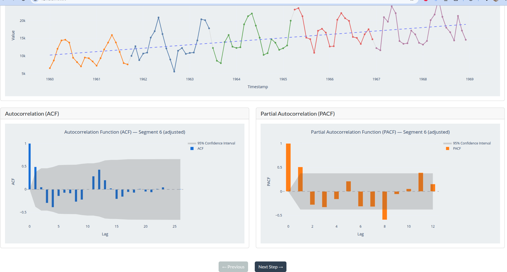
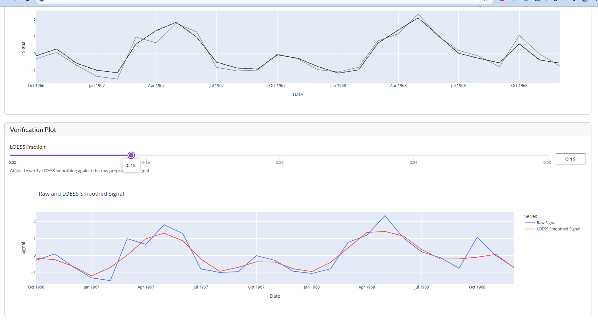
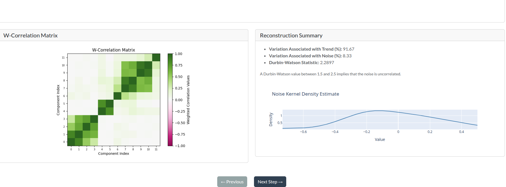
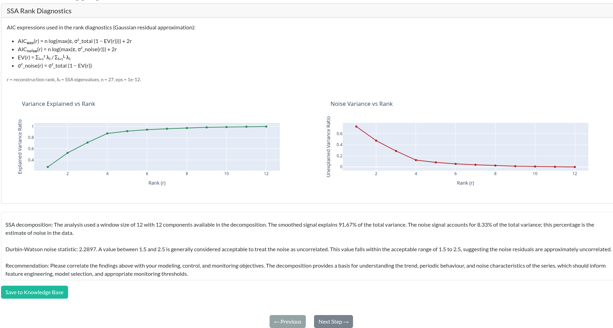

# Car sales example:

This example uses the [monthly car sales data](../data/monthly-car-sales.csv). Its
ground truth is upward trend plus a strong 12-month seasonal cycle. The process
classifier verifies the annual pair on the full 108-observation series. The final
24-observation active regime is retained as an indeterminate local view because
it contains only two annual cycles and is too short to confirm the full-series
periodic structure independently.

This makes the series a useful example of scope separation: the full history
supports a defensible trend-plus-seasonality interpretation, while a short recent
segment may not.

Most of the workflow follows the same sequence used elsewhere in the project. The main goal here is to illustrate the most relevant aspects of the analysis and to focus on the diagnostic evidence that supports the chosen decomposition. For the remaining procedural details, readers can follow the same pattern described in the coffee example.

## 1. Preliminary analysis: recognizing the signal structure before decomposition

The first stage is to inspect the raw series. The view reveals an upward movement
and a recurring annual pattern, with spring/summer peaks and winter troughs.

The periodic diagnostic estimates a 12-month period with a verified SSA pair.
This is not a generic trend-cycle interpretation: the full series has enough
annual repetitions to support a specific fixed seasonal cadence.

## 2. Decomposition: separating the long-run movement from the residual structure

Once the signal has been assessed, the next step is decomposition. Using SSA, the series is separated into interpretable components and reconstructed to show how the extracted structure explains the observed behavior. The decomposition view shows the signal broken into its main operating parts, and the reconstruction view illustrates how well those components explain the underlying dynamic.

The decomposition separates long-run trend, the verified annual seasonal pair,
and residual variation. The short active regime is reported as indeterminate,
not as contradictory evidence against the full-series 12-month result.

The verification step then checks whether the extracted components behave in a statistically defensible way. A key diagnostic is the relationship between the noise component and the trend-cycle component. If the decomposition is appropriate, the residual noise should not simply mirror the trend-cycle structure. The correlation analysis for this example indicates that the relationship is acceptable, meaning the noise component is not overly redundant with the trend signal.

This is reinforced by the Durbin-Watson statistic, which falls within the generally acceptable range of 1.5 to 2.5. This suggests that the residuals are not exhibiting strong serial dependence, which is critical when deciding whether the decomposition has produced a credible signal/noise split. Taken together, these diagnostics support the conclusion that the series has been decomposed into meaningful components and that the remaining noise is not simply a disguised version of the trend-cycle component.

## 3. Model verification and observation logging

The final stage of the workflow is about confidence and traceability. A decomposition may look plausible on its own, but the analyst also needs to record the evidence behind the interpretation so it can be reviewed, compared, and reused. That is why the project includes model verification and observation logging as part of the formal workflow.

This stage records the selected analysis window, the observed signal dynamics, the decomposition diagnostics, and the conclusions reached from them. In practical terms, it creates a durable record of the reasoning process: what was analyzed, how the series was segmented, which decomposition settings were applied, and which diagnostics supported the final interpretation. That record is especially valuable for iterative analysis, because it makes it possible to revisit the same series later and compare earlier conclusions against updated evidence.

The monthly car sales example therefore illustrates both expected decomposition
and scope discipline: the full series supports trend plus a 12-month seasonal
cycle, while the short terminal regime must not be over-interpreted.