# Coffee example: a segment-first workflow in practice

This example follows the `tseda` workflow on the monthly coffee prices series. It is designed to mirror the sequence described in `about_tseda.md`: start with a broad preliminary assessment, then isolate a segment of interest, run SSA decomposition on that segment, and finally validate the result with diagnostics and operational interpretation.

This example illustrates how the variance components of the signal, together with the broader context of the observation period, are captured through multiple plots, an iterative analysis workflow, validation of modeling choices, and the logging of findings for future reference. Although independent tools can perform these steps, this toolkit consolidates a practical workflow into a single interface for operational planning and model development.

## 1. Preliminary analysis: understand the signal before decomposing it

The workflow begins by loading the raw coffee series and summarizing its basic structure. The first view shows the data loaded into the system and gives the analyst a high-level view of the time series: the level, the obvious seasonal or cyclical behavior, and the time window being analyzed.

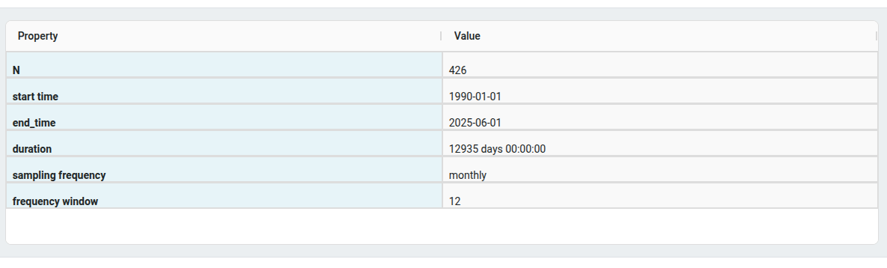

Once the series is in place, the next step is to inspect the distribution and basic shape of the observations. The histogram and box plot summarize where the signal spends most of its time and whether there are long tails or irregular concentration in one region.

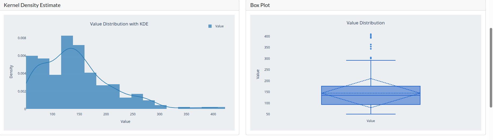

These preliminary diagnostics help answer a simple but important question: does the signal show enough structure to justify decomposition and further modeling? In the coffee example, the raw values are not flat or random. They have a clear central tendency, visible spread, and a recurring pattern that is consistent with a signal that is worth decomposing rather than treating as noise alone.

## 2. Regime selection: identify the segment to analyze

The next stage in the workflow is segmentation. `tseda` applies change-point detection to the raw series and identifies contiguous periods with broadly similar statistical behavior. The coffee series spans more than three decades, from 1991 to the present, and contains several distinct statistical regimes. These regimes are identified and plotted automatically. In practice, analysts are usually most interested in the current regime. Occasionally, however, the most recent regime contains too little data to support a meaningful decomposition. In those cases, `tseda` applies the half-life based window adjustment described in [half_life_window_adjustment.md](../half_life_window_adjustment.md) to define a representative recent segment for analysis. If the final segment is too short, then the UI will indicate this as shown below.

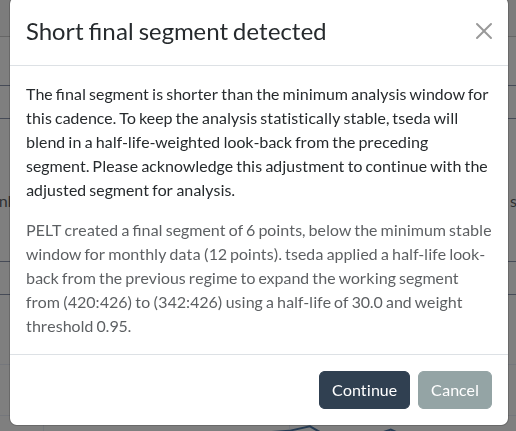

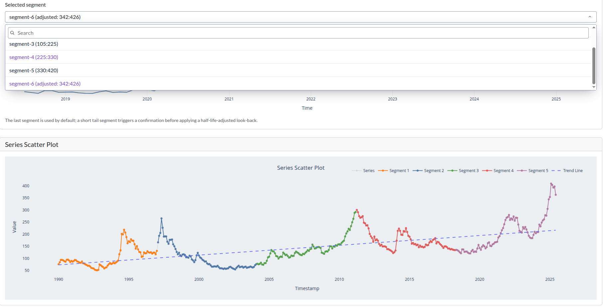

The adjustment itself is shown in the segment-level view. Rather than leaving the last segment at a misleadingly small length, the system defines the effective working window as the adjusted final segment. This is the working series used for the decomposition and downstream panels.The key idea here is that further analysis beyond this point is for a particular segment. The most recent regime is the default focus, because it reflects current operating conditions, but any regime can be selected for deeper review. The UI permits this.

After segment selection is either confirmed or selected by the user, the system computes ACF and PACF on that segment.

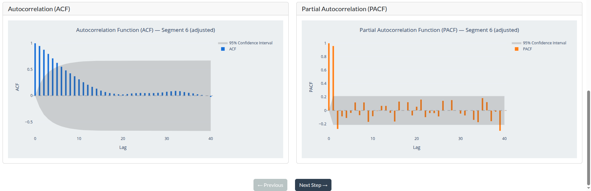

The selected recent segment is then decomposed with SSA. The decomposition results are shown below to illustrate how the trend, seasonal, and residual components are separated.

## 3. Segment decomposition: apply SSA to the selected regime

Once a coherent segment is selected, the analysis turns from regime identification to decomposition. In this stage, `tseda` applies Singular Spectrum Analysis (SSA) to the selected segment, where the window length and grouping are chosen to best reflect the dominant structure of that regime. This yields the variance components commonly grouped under trend, seasonality and noise.

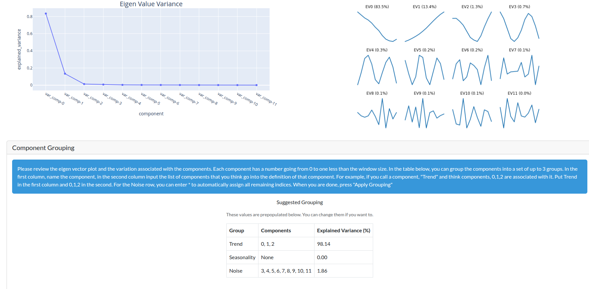

This view makes the decomposition concrete. The trend component captures the broad movement of the signal, the periodic component captures recurrence and seasonal structure, and the residual captures variation that remains after the main components are extracted. The analyst can ask whether the decomposition is logically coherent: do the extracted components line up with expected signal behavior, and does the extracted structure explain the observed regime? The reconstruction summary plot answers that question.

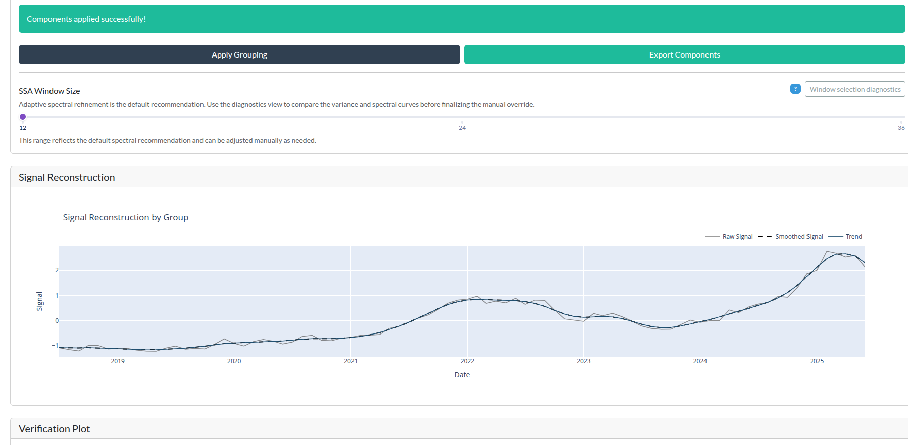

In a serious operational workflow, this is the point where the analyst begins to reason about process behavior. Is there evidence of a long-running trend? Is the seasonal component stable? Are there periods where the residual becomes more variable, suggesting that the operating regime has changed again or that a more detailed model is warranted? It is possible to run change point analysis on the variance components to answer this question. The software does this for us.

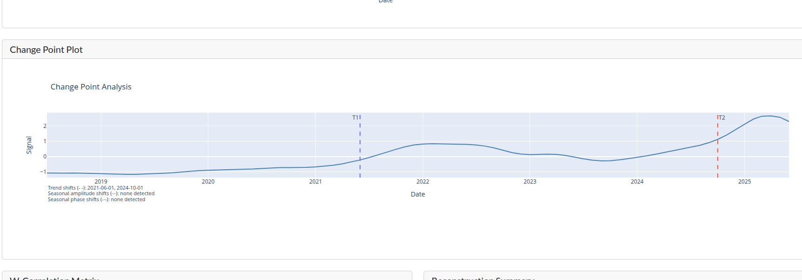

An important consideration in evaluating the quality of the decomposition is to evaluate the correlation between the identified variance components. If the grouping of the components is correct and the window selection is correct, then we should get groups of uncorrelated components. The weighted correlation plot is especially informative here: it shows whether the extracted trend and noise components are effectively uncorrelated, and it helps confirm that the residuals do not simply mirror the trend structure. The noise structure is another consideration. If the decomposition is acceptable, then the noise should not have serial correlation. A durbin-watson statistic in the 1.5 to 2.5 range is generally considered acceptable.

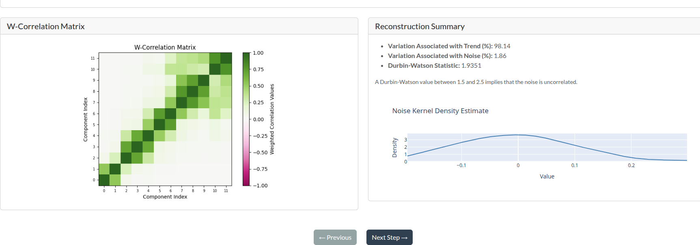

When the trend and noise components are weakly correlated and the Durbin-Watson statistic is in range, the decomposition is considered acceptable for operational use. In this example, the pattern supports the conclusion that the components are meaningfully separated rather than being redundant copies of the same underlying variation.

### LOESS comparison and change-point review

The project also supports validation against a smoothing or trend-estimation approach such as LOESS. This helps determine whether the decomposition recovers a broadly similar signal shape compared with a more classic local smoothing method.

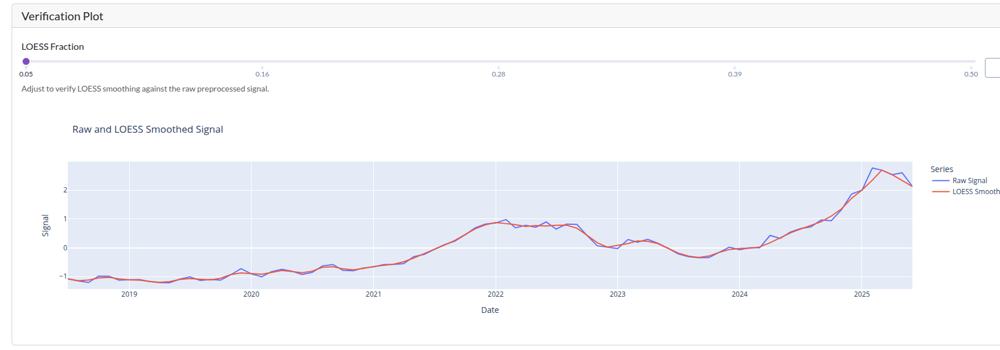

## 4. Model validation and observation logging

The final stage of the workflow is about defensibility and reproducibility. It is not enough to have a plausible decomposition; the analyst needs to preserve the evidence behind it. `tseda` therefore supports observation logging and the capture of model-validation metadata so the reasoning is retained and reusable.

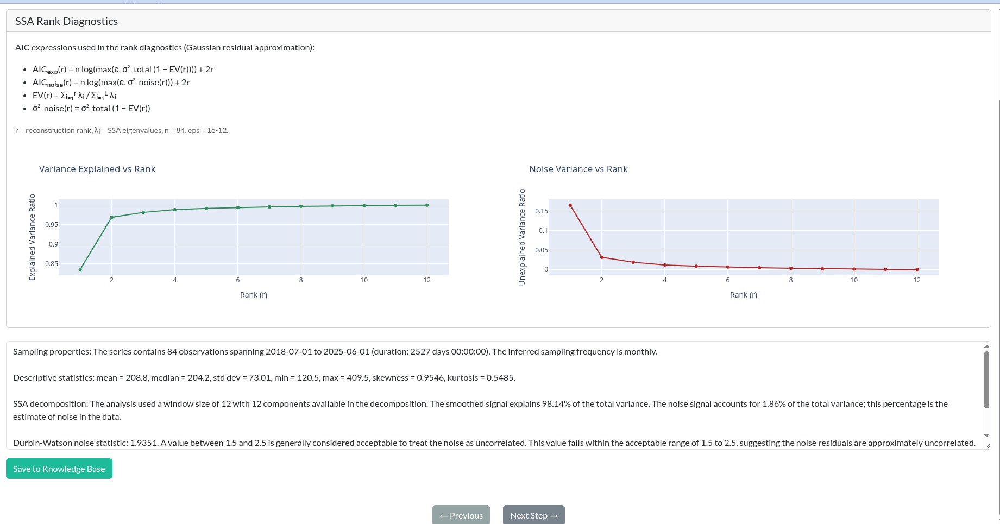

This stage records the selected segment, the decomposition settings, the validation diagnostics, and the resulting interpretation. That record is useful for future comparisons, for auditability, and for team handoff. It also makes the workflow repeatable: if the same dataset is revisited later, the analyst can find the earlier assumptions and compare them with the current state.

## 5. Interpreting the result

The coffee price example shows the core `tseda` workflow in action:

1. Raw data is loaded and summarized.
2. A histogram, box plot, and preliminary ACF/PACF diagnostics highlight the signal’s shape, concentration, and serial dependence.
3. The weighted correlation view checks whether the trend and noise components are not strongly correlated and whether the decomposition passes the Durbin-Watson acceptability check.
4. The series is segmented into operating regimes.
5. The final segment is checked for minimum stability and adjusted when needed.
6. A selected segment is decomposed by SSA into interpretable components.
7. LOESS and change-point diagnostics validate the decomposition.
8. The final state is logged and preserved for later review.

This is the real value proposition of `tseda`: it does not require analysts to guess at the right decomposition in isolation. It provides a structured, documented workflow that makes the transition from raw time series to interpretable variance components explicit, auditable, and repeatable.

For coffee prices, that means the analyst is not just looking at a graph of prices. They are looking at a regime-centered decomposition that distinguishes recurring structure from transient variation, identifies where the signal is conceptually stable, and records the reasoning that supports the model decisions.
