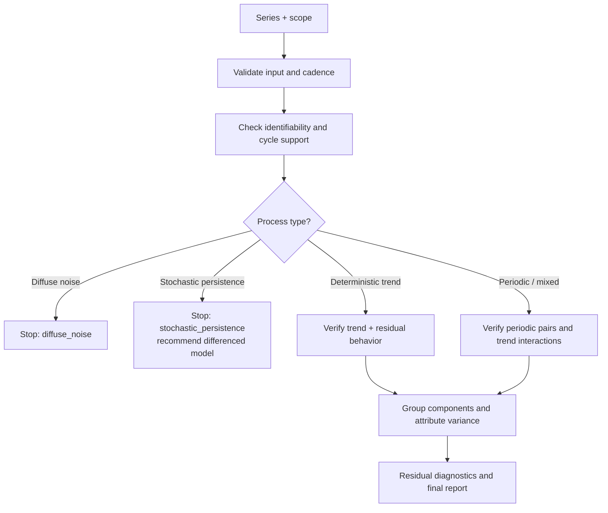

# Sequential Decomposition and Variance Attribution Specification

## Purpose

This document defines the ordered procedure for testing the characteristics of a
time series, decomposing it with Singular Spectrum Analysis (SSA), and identifying
the portion of variation associated with each accepted component.

The procedure is process-aware: it does not assume that a concentrated eigen
spectrum is deterministic signal. The sequence distinguishes:

- diffuse noise,
- stationary irregular variation,
- deterministic trend,
- stochastic persistence,
- verified periodic structure,
- mixed processes, and
- indeterminate evidence.

This specification implements the interpretation rules in
[`process_aware_ssa_design.md`](process_aware_ssa_design.md). Numerical thresholds
come from `src/tseda/config/tseda_config.yaml`; values shown here are decision
roles, not hard-coded implementation constants.

## Required outputs

For every analysis scope, retain:

1. the input range and number of observations;
2. cadence, gap/zero counts, and preprocessing decisions;
3. candidate periods and evaluated SSA windows;
4. process classification and confidence;
5. decomposition suitability;
6. accepted SSA component indices by semantic group;
7. reconstructed series for each group;
8. eigen-spectrum and reconstruction variance attribution;
9. residual diagnostics;
10. uncertainty or reasons why no conclusion was reached.

The two scopes are:

- **full series** — used for slow and globally recurring structure;
- **active regime** — used for current local behavior and regime-specific testing.

They are reported independently because a short final regime may not contain
enough cycles to reproduce a valid full-series seasonal pattern.

## Variance terminology

Two variance measures must not be confused.

### 1. SSA spectrum allocation

For sorted trajectory-matrix eigenvalues
\(\lambda_1 \geq \lambda_2 \geq \dots \geq \lambda_L\), the spectral share of
component \(i\) is:

\[
E_i = \frac{\lambda_i}{\sum_{j=1}^{L}\lambda_j}.
\]

For a group \(G\) of SSA components:

\[
E_G = \sum_{i \in G} E_i.
\]

This quantity describes the component group's share of the SSA trajectory-matrix
energy. It is useful for ranking and grouping eigentriples, but it is not, in
general, identical to the share of variance in the original observation-scale
series.

### 2. Reconstruction variance allocation

Let:

- \(x\) be the final SSA-preprocessed series;
- \(\hat{x}_G\) be the diagonal-averaged reconstruction of group \(G\);
- \(r=x-\sum_G\hat{x}_G\) be the final residual.

SSA implementations may standardize internally. Report metrics in the recorded
analysis scale and, where an inverse transform is available, also in the original
measurement scale. Do not subtract or compare values produced on different scales.
Report scale-qualified variance metrics for each reconstructed group:

\[
V_G^{raw}=\operatorname{Var}(\hat{x}_G)
\]

and normalized diagnostic shares:

\[
S_G=\frac{\operatorname{Var}(\hat{x}_G)}
{\operatorname{Var}(x)}.
\]

These normalized variances are descriptive, not additive, because reconstructed
groups can covary:

\[
\operatorname{Var}(x)\neq
\sum_G\operatorname{Var}(\hat{x}_G)
\]

unless cross-covariances are included.

For covariance-aware reconstruction attribution, define the complete set of
components as all semantic groups plus the residual:

\[
\mathcal{C}=\{G_1,\ldots,G_m,r\}.
\]

For each reconstructed group \(G\), report:

\[
A_G =
\frac{
\operatorname{Var}(\hat{x}_G)
+ \sum_{H\in\mathcal{C},\,H\ne G}\operatorname{Cov}(\hat{x}_G,\hat{x}_H)
}
{\operatorname{Var}(x)}.
\]

Using the corresponding allocation for the residual and an exact reconstruction
identity, the complete attributions sum to one. An individual covariance-adjusted
quantity can be negative when anti-correlated groups are poorly separated. Such a
result is a separation warning, not a percentage to be clipped silently.

Also report:

- residual variance ratio
  \[
  R_V=\frac{\operatorname{Var}(r)}{\operatorname{Var}(x)};
  \]
- reconstruction \(R^2\), where useful;
- total spectral share \(E_G\);
- group variance \(V_G^{raw}\);
- normalized descriptive share \(S_G\);
- covariance-adjusted attribution \(A_G\), including the residual allocation.

The UI may present rounded percentages, but the machine-readable result must
retain both spectral shares and observation-scale measures.

## Sequential decision procedure

The tests are ordered because later tests require conclusions from earlier ones.
Do not independently label a leading SSA component as trend or seasonality and
then test for incompatibilities afterward.

### High-level flow: 6 coarse stages with process classification

The full procedure can be read as six logical stages instead of a long chain of
fine-grained checks. The first and most important abstraction is the process
classification gate: the series type must be identified before meaningful
component attribution is attempted.

1. Define the analysis scope and confirm the data are valid.
2. Check whether the series is identifiable and has enough signal support.
3. Identify the dominant process class: diffuse noise, stochastic persistence,
   deterministic trend, periodic structure, or mixed evidence.
4. Only if the process is not blocked by persistence/noise, verify whether a
   deterministic trend is actually supported.
5. Test whether verified oscillatory pairs constitute seasonality.
6. Attribute variance, assess residuals, and report the outcome with caveats.

This abstraction matches the detailed procedure below but reduces the cognitive
load for readers who need the process map, not the implementation-level
threshold checklist. The process-type decision is intentionally placed early
because a random walk with drift is blocked before a deterministic trend label is
accepted.

## Step 0 — Select and describe the scope

1. Construct the full-series analysis range.
2. Construct the active-regime range using the shared segmentation service:
   - explicit user bounds, when supplied;
   - otherwise reproducible PELT boundaries;
   - otherwise the configured deterministic chunk fallback;
   - existing half-life adjustment only for an eligible short final segment.
3. Store the original and adjusted boundaries.
4. Record the number of observations and elapsed duration.
5. Infer cadence and distinguish calendar-day data from business-day data.

**Conclusion:** The scope is reproducible.

**If this fails:** Return `indeterminate` and identify the invalid boundary or
cadence condition. Do not continue with an implicit range.

## Step 1 — Validate values, cadence, and missingness

1. Reject an empty, non-numeric, all-missing, or constant scope.
2. Identify explicit missing values, timestamp gaps, duplicate timestamps, and
   structural zeros.
3. Do not interpolate gaps merely to create an SSA matrix.
4. For a gapped regularly sampled physical series:
   - split the scope into contiguous runs;
   - retain runs with at least the configured run-level cycle floor;
   - aggregate evidence by observation count;
   - use an irregular-time spectral diagnostic only as additional evidence.
5. Preserve explicit zeros for count series; report them as source semantics.
6. Confirm that a candidate SSA window leaves a residual tail of at least the
   configured minimum size.

**Conclusion:** The scope is identifiable, or its lack of identifiability is
quantified.

**If no qualifying run exists:** Return `indeterminate`. Do not fill the gaps
silently.

## Step 2 — Establish candidate periods and cycle support

1. Define cadence-appropriate candidate periods, for example:
   - hourly: 24 and 168;
   - daily: 7, with 5 only for an explicitly business-day series;
   - weekly: 4 or 8;
   - monthly: 12, 24, or domain-configured long periods;
   - quarterly: 4 or 8.
2. Add domain overrides only through configuration or a recorded analysis
   parameter.
3. For each period \(P\), calculate:
   \[
   C_P=\frac{N}{P},
   \]
   the number of available complete cycles.
4. Mark a period underpowered when \(C_P\) is below the configured minimum.
5. Define one or more valid windows, initially \(L=P\) and optionally \(L=2P\),
   subject to \(L\le N/2\) and the residual-tail requirement.
6. For quasi-periodic behavior, store an accepted band
   \([P_{low},P_{high}]\), not one exact integer.

**Conclusion:** Candidate periods are ordered by interpretability and evidence
power.

**If no candidate period is testable:** Continue to non-periodic process
classification, but no SSA seasonality component may be created.

## Step 3 — Test for an essentially diffuse process

Test the level SSA spectrum for white-noise-like diffusion:

1. Compute normalized eigenvalue shares \(E_i\).
2. Compute top-\(k\) concentration and tail diffusion.
3. Estimate the log-eigenvalue slope and fit quality.
4. Measure leading EOF smoothness and zero crossings.
5. Compare the spectrum with diffuse-noise controls.

Diffuse noise is supported when:

- concentration is low and broadly distributed across components;
- no smooth, dominant low-frequency mode is present;
- no candidate period survives independent verification;
- level and first-difference behavior do not reveal stable structure.

**Conclusion:** `diffuse_noise`.

**Variance result:**

- no `Trend`, `Seasonality`, `Persistence`, or `Signal` reconstruction is
  accepted;
- residual variance is the series variance;
- reconstruction variance ratios are not reported as meaningful decomposed
  evidence;
- decomposition suitability is `unsuitable`.

## Step 4 — Test for stochastic persistence

This safeguard precedes deterministic trend and seasonality acceptance.

1. Characterize level-spectrum:
   - leading concentration;
   - smooth power-law-like decay;
   - slope and fit quality;
   - EOF smoothness and number of zero crossings;
   - whether the persistence signature remains after cadence-paired candidates
     are considered.
2. Difference the level series once.
3. Recompute the SSA spectrum and concentration on the differences.
4. Test whether the level concentration and smooth low-frequency modes collapse
   in the differenced spectrum.
5. Run configured unit-root and stationarity diagnostics:
   - ADF in levels and differences;
   - KPSS in levels;
   - constant and trend alternatives when a deterministic trend is plausible.
6. Compare observed joint features with matched:
   - white-noise nulls;
   - deterministic-trend plus noise nulls;
   - random-walk or random-walk-with-drift nulls;
   - persistent AR(1) nulls.
7. Use the configured Monte Carlo budget. A timeout produces
   `monte_carlo_percentile = null` and an explicit flag.

Stochastic persistence is supported when:

- level concentration is high;
- decay is smooth and steep;
- leading EOFs are smooth and low frequency;
- first differences become substantially more diffuse;
- the persistence signature is not adequately explained by a deterministic
  cadence-paired component alone;
- stationarity/unit-root evidence and the matched null comparison are consistent.

The supported subtype may be:

- `unit_root_like`,
- `high_persistence_ar`, or
- `persistent_with_regimes`.

**Conclusion:** `stochastic_persistence` is a stop condition for deterministic
Step-2 SSA. Record `Persistence` as a process classification, not as a
reconstructed low-frequency SSA group. Do not interpret smooth level modes as
deterministic trend or seasonality. If a separately justified periodic component
is independently verified, the result may be `mixed`, but the persistent level
still requires a stochastic or differenced modeling action.

**Variance result:** No deterministic reconstruction variance is attributed at
this stage. Variance change detection, if requested, belongs to first
differences or innovations produced by an explicit stochastic-trend model.
Any resulting residual supplied back to `tseda` is a new independent analysis.

## Step 5 — Verify deterministic trend

Do not call a low-frequency SSA mode deterministic trend only because it is
smooth.

1. Exclude modes already classified as stochastic persistence.
2. Compare the reconstruction with finite deterministic trend alternatives.
3. Test whether residuals after the proposed trend remove smooth drift without
   leaving a persistent-stochastic signature.
4. Inspect changes in slope or level for regime boundaries.
5. Require positive, reproducible explained variance and acceptable residual
   behavior.

**Conclusion:** `deterministic_trend`, or `mixed` when deterministic trend
coexists with verified periodic structure.

**Variance result:** Assign verified deterministic low-frequency, non-oscillatory
components to `Trend`.

**If drift can be either deterministic or stochastic:** Return
`indeterminate` or report both classifications with lower confidence rather than
forcing a `Trend` label.

## Step 6 — Verify periodic structure

A period is accepted sequentially. All required tests must pass.

1. **Cycle support:** the scope or aggregated eligible runs contain the
   configured minimum number of cycles.
2. **Eigen-pair test:** two adjacent eigenvalues satisfy pair similarity.
3. **Oscillation test:** corresponding EOFs or reconstructed series are
   phase-quadrature-like rather than both representing a monotonic trend.
4. **Period test:** the pair reconstruction has a fitted period in the accepted
   cadence-specific band.
5. **Independent spectral test:** detrended or residual period strength exceeds
   the configured threshold.
6. **Persistence test:** the result is not better explained by stochastic
   persistence or a nonstationary low-frequency spectrum.
7. **Robustness test:** evaluate whether the period remains under `L=P` and,
   where valid, `L=2P` or across qualifying contiguous runs.

**Conclusion:** `periodic`, or `mixed` when another accepted process class is
present.

**Variance result:** Assign the verified eigenpair to `Seasonality` and associate
it with the accepted period, confidence, cycle count, spectral share, and
reconstructed variance.

**Hard rule:** A singleton eigencomponent is never sufficient for a
`Seasonality` group. It may be `Trend`, `Persistence`, or unassigned.

## Step 7 — Assign components without using Durbin-Watson to force semantics

After process classification, provided the scope is not a pure
`stochastic_persistence` or `diffuse_noise` stop:

1. Allocate verified periodic pairs to `Seasonality`.
2. Allocate deterministic non-oscillatory modes to `Trend`.
3. Allocate all remaining eigentriples to `Noise`, or retain an explicit
   `Unclassified` group if the evidence is contradictory.
5. Reconstruct groups in a fixed order and store group membership.
6. Ensure every component index is assigned exactly once for the final
   reconstruction.

Durbin-Watson is then calculated on the final residual:

\[
r=x-\hat{x}_{Trend}-\hat{x}_{Seasonality}.
\]

The statistic is classified as:

- inside the configured reference band,
- below the band,
- above the band, or
- unavailable/unstable.

Do not move a component from `Noise` to `Trend` or `Seasonality` merely to force
Durbin-Watson into `[dw_low, dw_high]`.

## Step 8 — Attribute variance and verify separation

For the final reconstruction:

1. Calculate \(E_G\) for every group from eigenvalues.
2. Calculate \(V_G^{raw}\), \(S_G\), and \(A_G\) on the original observation
   scale.
3. Calculate the residual variance ratio \(R_V\).
4. Calculate pairwise group correlations/covariances and weighted correlations
   used to assess separability.
5. Flag:
   - negative covariance-adjusted attribution;
   - large unexplained residual covariance;
   - near-duplicate reconstructed groups;
   - normalization scale changes across scopes;
   - window sensitivity that changes the accepted classification.

Interpretation:

- high \(E_G\) means an SSA mode has high trajectory-matrix energy;
- it does not alone prove that the mode is deterministic;
- high \(S_G\) means a reconstruction varies strongly on the observation scale;
- a low \(R_V\) means the accepted reconstruction leaves little residual
  variance, but does not by itself prove correct semantics;
- disagreement between spectral and reconstruction variance must be retained as
  a separation warning.

## Step 9 — Test the residual

Choose the residual according to the process classification:

| Classification | Variance/change-point input |
|---|---|
| `diffuse_noise` | Original series; mainly a null/suitability check |
| `deterministic_trend` | Level reconstruction residual |
| `periodic` / `mixed` | Reconstruction residual after trend and verified periodic components |
| `stochastic_persistence` | First differences or innovation residuals |
| Operational counts | Explicitly documented count transform; retain zero semantics |

Then report:

- residual variance and standard deviation;
- Durbin-Watson and distance from target interval;
- ACF/PACF evidence;
- distribution/KDE diagnostics;
- PELT variance change points with uncertainty and timestamps;
- change points in trend, periodic amplitude, and phase where applicable.

**Conclusion:** Residual behavior is stationary/irregular, autocorrelated,
heteroscedastic, or insufficiently resolved.

## Step 10 — Resolve the final conclusion

Use the following precedence:

1. `indeterminate` if cadence, scope, or minimum cycle support is invalid.
2. `diffuse_noise` if the spectrum is genuinely diffuse and no structure is
   verified.
3. `stochastic_persistence` if the persistence safeguard is supported and no
   stronger periodic explanation exists.
4. verified periodic components plus deterministic trend/persistence as
   `mixed` when appropriate.
5. `deterministic_trend` only after the persistence alternative is tested.
6. `stationary_irregular` when finite-memory residual structure is present but
   no verified deterministic group is identifiable.

The final report must state:

- classification,
- confidence and its limitations,
- decomposition suitability,
- active scope,
- accepted periods,
- rejected candidate periods and reasons,
- group component indices,
- spectral and observation-scale variance,
- residual diagnostics,
- variance change points,
- caveats caused by short history, gaps, or process ambiguity.

## Benchmark interpretation rules

| Series | Expected sequence outcome |
|---|---|
| `white_noise_data` | Diffuse-noise gate rejects deterministic reconstruction. |
| `hyndman_goog_daily_close` | Persistence safeguard classifies stochastic persistence; no singleton seasonality. |
| `coffee_prices` | Persistence/regime evidence; no forced deterministic seasonality. |
| `trimmed_biomass` | Trend/regime structure without forcing a stable short cycle. |
| `monthly_car_sales` | Full-series 12-month pair; short active-regime uncertainty. |
| `uci_air_quality_hourly_co` | 24-hour evidence aggregated from eligible contiguous runs. |
| `ticket_resolution_hourly_nyc311` | 24-hour and weekly count-seasonality evidence, with structural-zero caveat. |
| `hyndman_arrivals_quarterly_japan` | Four-quarter pair; boundary DW reported as uncertainty. |
| `hyndman_hyndsight_daily_pageviews` | Seven-day pair; `L >= 7`. |
| `hyndman_sunspot_monthly_area` | Long-cycle band near 132 months, analyzed on the full series. |
| `hyndman_usconsumption_quarterly_consumption` | Weak/no deterministic four-quarter seasonality; stationary/irregular outcome allowed. |

See [`test_case_ground_truth.md`](test_case_ground_truth.md) for source provenance
and the external evidence underlying these expectations.

## Minimum test obligations

Implementation must test the sequence, not only final booleans:

1. white noise stops at Step 3;
2. a random walk stops at Step 4 and never creates `Seasonality`;
3. a deterministic linear trend reaches Step 5 but is not classified as a
   random walk;
4. a known periodic process reaches Step 6 with the expected pair and period;
5. a random walk plus an independent periodic signal produces `mixed`;
6. a gap-filled or imputed dataset is rejected unless that preprocessing was an
   explicit, recorded input transformation;
7. an active segment with fewer than the required cycles is `indeterminate`;
8. a group is either `Trend`, `Seasonality`, `Persistence`, `Noise`, or explicitly
   `Unclassified`, with no duplicate component indices;
9. covariance-adjusted variance reports can identify poor component separation;
10. changing Durbin-Watson alone cannot change process classification.

## Prohibited conclusions

- Do not call high eigenvalue concentration “seasonality.”
- Do not call a random walk deterministic trend because its first EOF is smooth.
- Do not call a singleton mode an oscillatory component.
- Do not infer a global period from a segment with fewer than the minimum cycles.
- Do not force components into the model to satisfy Durbin-Watson.
- Do not present SSA eigenvalue percentages and observation-scale variance shares
  as interchangeable.
- Do not hide gaps, structural zeros, normalization, short-history warnings, or
  period-estimation uncertainty.

## Summary diagram

The decomposition is a gated sequence, not a set of independent labels:

1. define full-series and active-regime scopes;
2. validate cadence, gaps, and identifiability;
3. test candidate periods;
4. reject diffuse noise or identify stochastic persistence before assigning
   deterministic groups;
5. verify deterministic trend and oscillatory SSA pairs;
6. if supported, allocate `Trend`, `Seasonality`, and `Noise`; for stochastic
   persistence, record the stop classification instead of entering Step 2;
7. attribute spectral and observation-scale variance;
8. diagnose residuals and report uncertainty.

The D2 source below is maintained as
[`decomposition_process_flow.d2`](decomposition_process_flow.d2).

### First-level outcomes and recommended actions

The first pass stops after assigning one primary process outcome for each scope
and recommending the appropriate next modeling action. It is not a recursive
SSA workflow.

| First-level outcome | Meaning | Suggested processing action |
|---|---|---|
| `diffuse_noise` | The spectrum is broadly diffuse and no deterministic structure is supported. | Do not force an SSA Trend/Seasonality decomposition. Investigate a white-noise, IID, ARMA, distributional, or domain-specific monitoring model. |
| `stationary_irregular` | Finite-memory or irregular structure may exist, but a stable deterministic SSA trend/period is not verified. | Consider stationary ARMA, regression, intervention, count, or anomaly models. Continue SSA only if later residual evidence independently verifies an oscillatory pair. |
| `deterministic_trend` | A finite trend is better explained deterministically than as a unit-root-like process. | Model the trend explicitly, then retain residuals for residual diagnostics or a separately verified periodic test. |
| `stochastic_persistence` | A random-walk-like, high-persistence AR, or stochastic-trend process is more defensible than a deterministic SSA trend. | Do not interpret smooth SSA level modes as deterministic signal. Investigate random walk, ARIMA with differencing, local-level/state-space, or persistent AR models on the original series. |
| `periodic` | One or more cadence-appropriate oscillatory SSA pairs pass the period, pair, and cycle-support tests. | Proceed with the verified periodic components and a separately justified treatment of trend/noise. |
| `mixed` | Verified periodic structure coexists with deterministic trend and/or stochastic persistence. | Process the persistent level with a stochastic-trend or differencing model and retain independently verified periodic components in the combined model. |
| `indeterminate` | The evidence is contradictory or the scope is too short/gapped to distinguish valid alternatives. | Do not force a decomposition. Expand history, choose another regime, repair/regularize data through an explicit documented step, or collect more cycles. |

### Stochastic-persistence and noise residual handoff

The suggested action for `stochastic_persistence` is to model the stochastic
level and then inspect its innovations, first differences, or model residuals.
The suggested action for `diffuse_noise` is to use a stochastic noise or
domain-specific model rather than fabricate a decomposition.

Those external models may still leave unexplained residual structure. The package
can analyze that residual only if it is supplied as a separate, explicitly
defined series and it independently passes the identifiability tests in this
specification. Examples include a verified periodic cycle, a variance shift, or
finite-memory autocorrelation in the innovation process.

This handoff is a recommendation boundary, not an implemented recursive
analysis. The first-level workflow:

1. makes the process classification;
2. explains why that classification is supported;
3. recommends a stochastic, deterministic, periodic, or no-decomposition action;
4. stops.

If the user subsequently supplies the residual or differenced series, it begins
a new independent analysis with new scope metadata, thresholds, and conclusions.

#### Pareidolia guardrail

For a pure random walk, visual smoothing can create **pareidolia**: the human
tendency to perceive meaningful patterns in random or stochastic variation.
Smooth-looking level changes are therefore not evidence of deterministic trend,
cycle, regime, or structure.

All user-facing outputs must use this interpretation consistently:

> Stochastic persistence is consistent with a random walk, persistent AR process,
> or another stochastic trend. For a pure random walk, visual smoothing can create
> pareidolia—the tendency to see meaningful patterns in random/stochastic
> variation. Do not interpret smooth SSA level modes as deterministic trend or
> seasonality. This tool is not the right exploration choice for the level
> process.

The implementation must then stop deterministic SSA exploration for that scope,
recommend stochastic/differenced modeling, and require any subsequent residual or
innovation series to be supplied as a new independent analysis.

### Rendered flow (Mermaid)

This version emphasizes the classification-first view and makes the blocking
behavior explicit. The process-type decision happens before deterministic trend
or seasonality is accepted.



This high-level schema is intentionally coarse, but it preserves the crucial
sequence: a random walk with drift is blocked by the persistence gate before a
trend label is accepted.

### D2 source

```d2
direction: down

series: "Series + scope" {
  shape: cylinder
}
validate: "Validate input\n& cadence"
identify: "Check identifiability\n& cycle support"
classify: "Process type?\n(diffuse / persistent / trend / periodic / mixed)"
noise: "Stop: diffuse_noise" {
  style.fill: "#fde2e2"
}
persistence: "Stop: stochastic_persistence\nrecommend differenced model" {
  style.fill: "#e7f0ff"
}
trend: "Verify deterministic trend\n+ residual behavior" {
  style.fill: "#f3e8ff"
}
periodic: "Verify periodic pairs\n& trend interactions" {
  style.fill: "#e8f7e8"
}
component: "Group components\n& attribute variance"
residual: "Residual diagnostics\n& final report" {
  shape: document
}

series -> validate -> identify -> classify
classify -> noise: "diffuse"
classify -> persistence: "persistent"
classify -> trend: "deterministic trend"
classify -> periodic: "periodic / mixed"
trend -> component
periodic -> component -> residual
```

To render the standalone source:

```bash
d2 documents/decomposition_process_flow.d2 documents/decomposition_process_flow.svg
```

## When a series is indeterminate or unsuitable

`indeterminate` and `unsuitable` answer different questions and must not be
collapsed into one status.

### Indeterminate

The package has `indeterminate` evidence when it cannot distinguish a valid
process class with the configured confidence:

- the series is constant, empty, or non-numeric;
- the cadence or selected scope is not reproducible;
- too few observations or complete cycles remain after segmentation;
- no qualifying contiguous run remains after gaps are removed;
- trend-adjusted and stochastic-persistence alternatives remain contradictory;
- the active regime is too short to confirm a period that exists in the full
  series;
- configured diagnostics time out or are unavailable without a defensible
  fallback.

Indeterminate means **“not enough or contradictory evidence”**, not “white
noise” and not “proof that no structure exists.” The package must retain the
full-series result separately, along with the failed conditions and the next
analysis option.

### Unsuitable

A series is `unsuitable` when the package can classify the process evidence but
cannot support a deterministic SSA reconstruction. The canonical example is
`diffuse_noise`: variance is broadly distributed, no dominant deterministic
structure is verified, and reconstructing `Trend` or `Seasonality` would create
artefacts.

`stochastic_persistence` can be reliably classified while still being unsuitable
for a **deterministic Trend/Seasonality reconstruction**. In that case the package
must stop before Step 2, explain that smooth level motion is not evidence of a
deterministic signal, and recommend difference/innovation-based diagnostics. The
UI and API must also include the pareidolia guardrail above and must not permit
direct grouping to bypass the stop condition.

The report therefore carries independent fields for:

- process class;
- decomposition suitability;
- suitability reason;
- full-series result;
- active-regime result.

An indeterminate active regime does not invalidate a confirmed full-series
pattern. Likewise, an unsuitable deterministic decomposition does not erase a
valid process classification.