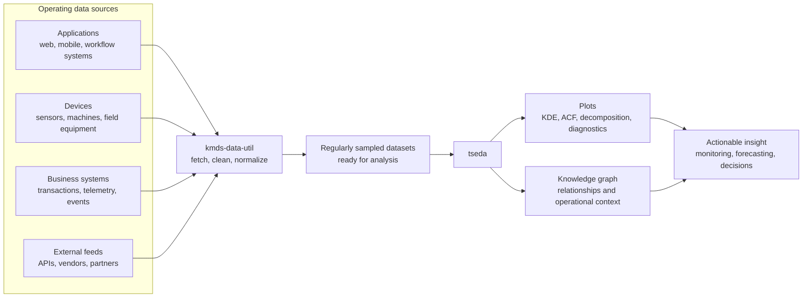

# Operational context for tseda

`tseda` is designed for a very common real-world problem: understanding a time series that is generated by an operational system, application, or device, and turning that raw signal into actionable context.

## 1. A metric or response is generated by a real system

You often have an application or system that produces a metric or response worth understanding. This may be the number of transactions on an online store, the readings from a sensor, or operational parameters from equipment in the field. The pattern is the same: a system emits signals continuously, and those signals are valuable because they reflect behavior, health, demand, or operational risk.

## 2. The data is collected and managed by operational platforms

These metrics are rarely stored in a single clean, curated archive. They are usually collected and managed by vendor platforms or custom applications built to support daily operations. The resulting data may be scattered across systems, subject to schema drift, or shaped by business logic that is not always obvious to analysts.

## 3. Historical datasets were once highly curated

Twenty years ago, much time series work was built around carefully curated datasets from governmental agencies or large corporations. These data products were expensive to acquire and were often reviewed by domain experts before being shared. That era produced canonical references such as the classic Diebold and Hyndman materials, which shaped how analysts thought about benchmark data.

## 4. Today, much of the data is machine-generated

Today, a great deal of useful data is generated by software systems and equipment rather than by formal statistical programs. Sensor streams, application logs, transaction counts, operational telemetry, and platform metrics are increasingly the default source of information. This kind of data is often rich and operationally relevant, but it differs from textbook time series in volume, noise, and complexity.

## 5. Managing these signals creates several practical challenges

This is the operational context that motivates `tseda`.

### a. Proliferation of data sources

There are many systems and devices generating signals. Modern organizations operate a large number of digital products, applications, and monitoring pipelines. The challenge is not just collecting the data, but understanding which time series matter, how they relate to one another, and which ones warrant attention.

### b. Understanding a signal is dynamic, not a one-time event

Managing these systems requires more than a snapshot. The underlying signal changes over time. Some behavior remains stable, while new behavior emerges as systems evolve. A useful analytic workflow must therefore support repeated reassessment and context preservation rather than a single static interpretation.

### c. New applications and initiatives need signal understanding

Creating new applications for business impact, operational planning, or decision support requires understanding the data behind the process. Before making a product change or improving a workflow, teams need to know whether the signal is stable, noisy, seasonal, trending, or regime-shifting.

### d. Hypothesis testing requires data literacy

Experimenting with new ideas, assumptions, or interventions also depends on understanding the data. Without a rapid read on the signal, teams can waste time testing the wrong explanations or drawing conclusions from artifacts rather than structure.

### e. Context is easy to lose in multi-signal operations

People often monitor multiple signals at once, and it is easy to lose the context that explains what happened. Recreating the historical context after the fact is expensive and error-prone when it requires extensive experimentation. A practical tool should help teams preserve the mental model behind an operational signal and quickly recover the dominant characteristics of a time series.

### f. Cold-start situations are common

New team members join, or analysts revisit old data after long gaps. In these situations, they often face a cold-start problem: they know very little about the raw series and need a quick, informed summary before deciding what to do next. The goal is to produce an understandable summary that helps the analyst move from unfamiliar data to a sensible next step.

### g. Recreating analysis from notebooks and scripts is cumbersome

Going back through old notebooks or scripts to reconstruct what a human analyst did is slow, fragile, and easy to get wrong. An AI agent reviewing legacy code can struggle to recover the same reasoning without domain context. A better approach is to provide a tool that works from the operational context itself, analyzes the dataset, and produces a clear, actionable summary the human can verify.

### h. A common repeated problem: fetch, clean, and summarize a signal

Tools to fetch and clean data from datasets can be created by LLM agents or already exist in many vendor platforms. `kmds-dataset-util` (for example, https://github.com/rajivsam/kmds-dataset-util) is one useful illustration, but many similar utilities are available. The point is simple: given regularly sampled data from a source, the repeated practical task is often to explore the signal and provide a trustworthy summary.

This is exactly the sort of challenge `tseda` is designed to help with: turning raw operational series into interpretable structure, diagnostic insight, and a basis for the next decision.

## Operational flow: from raw series to signal understanding

The repeated pattern in practice is not a single statistical exercise; it is a workflow:

1. A data source emits a regularly sampled signal.
2. A utility or platform fetches and prepares the data.
3. An analyst or agent inspects the series in context.
4. `tseda` summarizes the signal and highlights its structure.
5. The summary informs the next step: monitoring, forecasting, modeling, or intervention.

The following diagram is better expressed as Mermaid because it renders natively in GitHub Markdown and matches the operational flow of source systems -> cleaning utility -> regularized datasets -> `tseda` analysis -> plots and knowledge-graph context.

This workflow is the operational heart of `tseda`: it supports fast, repeatable, domain-aware understanding of time series that are generated by modern systems rather than curated textbook archives.

