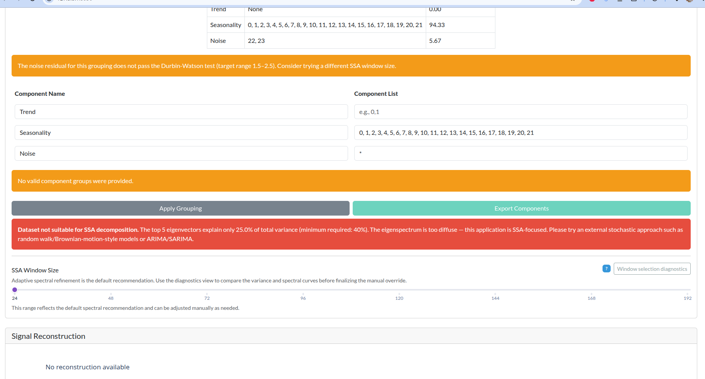

# White-noise example: when SSA is not the right tool

This example exists to illustrate a specific `tseda` feature: when a series has no sharp spectral structure and the variance is diffuse across the entire eigenspectrum, SSA should not be treated as a meaningful decomposition tool. In that situation, the signal is effectively noise-dominated, and the tool warns the user that the decomposition is not reliable.

## Purpose of the example

The purpose of this example is to show how `tseda` handles a dataset that is not suitable for SSA decomposition. The core idea is simple:

- if the eigenvalue spectrum is flat rather than sharply concentrated,
- if no single component or small group of components captures the structure,
- and if the energy is spread across the spectrum,

then the series is not meaningfully separable into trend and seasonality in the way SSA expects. In that case, `tseda` does not pretend that the decomposition is meaningful. Instead, it surfaces a warning and redirects the analyst to a stochastic/noise-based modeling approach such as a random walk/Brownian-motion model or an ARIMA/SARIMA workflow.

This is a critical design feature because a mathematically valid SSA decomposition can still be produced for a noise-dominated process, but the resulting trend and seasonality groups are not interpretable signal components. They are just statistical artifacts.

## What the UI shows

The screenshot below is the canonical example of this behavior. In the decomposition panel, the app reports that the series is not suitable for SSA decomposition and recommends switching to a noise-based approach.

The warning in the interface reads, in essence:

> Dataset not suitable for SSA decomposition. The top 5 eigenvectors explain only 25% of total variance (minimum required: 40%). The eigenspectrum is too diffuse — this application is SSA-focused. Please try an external stochastic approach such as random walk/Brownian-motion-style models or ARIMA/SARIMA.

## Why this is the expected behavior

The documentation for this workflow explicitly states that when a series is dominated by noise, the eigenspectrum looks flat and variance is spread roughly equally across eigenvectors. In that case:

- there is no single dominant component,
- the trend and seasonality groups are not distinct and interpretable,
- the residual is not a clean noise signal with a meaningful decomposition,
- and the process is better modeled with a stochastic error-driven approach rather than SSA.

This is not a failure of the algorithm. It is a feature of the workflow: the tool is helping the analyst recognize when SSA is simply the wrong modeling lens.

## Example narrative

A white-noise series or an unstructured random-walk like signal is a textbook case where SSA is not the right tool. In these cases the frequency content is diffuse, the spectrum never settles into a sharp peak, and the tool correctly refuses to over-interpret the decomposition. The correct response is not to force an SSA explanation, but to move to a noise-modeling workflow.

This example is therefore intended to demonstrate the guardrail behavior: `tseda` recognizes when the data do not support a meaningful SSA decomposition, warns the user explicitly, and directs them toward a better-suited model class.
